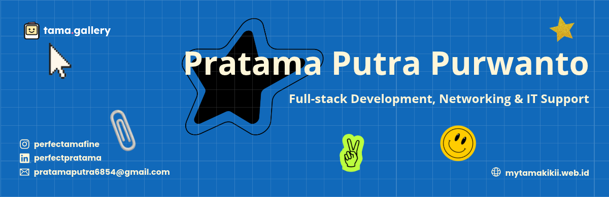

<picture><source media="(max-width:600px)" srcset="assets/name-typing-mobile.svg" /></picture>

Full-stack Developer · Networking · IT Support

   

<picture><source media="(max-width:600px)" srcset="assets/intro-tab-mobile.svg" /></picture>

<table class="about"><tbody><tr><td width="72%" valign="top">

I’m <strong>Tama</strong>, a Diploma III student in Informatics Engineering at <strong>Politeknik Negeri Cilacap</strong>, with a background in Computer and Network Engineering.

I enjoy building applications and figuring out how things connect, from backend features to networking. My practical work also includes everyday IT support. I’m still exploring where I want to specialize, learning through coursework, projects, and practical work.

</td><td width="28%" valign="top" align="center"> <a href="https://giphy.com/gifs/kpop-lee-sohee-riize-kVe84mNv2m37Acjgvo">via GIPHY</a></td></tr></tbody></table>

<picture><source media="(max-width:600px)" srcset="assets/stack-tab-mobile.svg" /></picture>

Tools and technologies from my portfolio. Still learning as I go.

<table><tbody><tr><td width="50%" valign="top"><strong>Frontend & UI</strong>
 &nbsp;  &nbsp;  &nbsp;  &nbsp;  &nbsp;  &nbsp;  &nbsp; 
</td><td width="50%" valign="top"><strong>Backend & databases</strong>
 &nbsp;  &nbsp;  &nbsp;  &nbsp; 
</td></tr><tr><td width="50%" valign="top"><strong>Networking & OS</strong>
 &nbsp;  &nbsp;  &nbsp; 
</td><td width="50%" valign="top"><strong>Mobile</strong>
 &nbsp; 
</td></tr><tr><td width="50%" valign="top"><strong>Workspace & tools</strong>
 &nbsp;  &nbsp;  &nbsp;  &nbsp;  &nbsp;  &nbsp;  &nbsp; 
</td><td width="50%" valign="top"><strong>AI-assisted workflow</strong>
 &nbsp;  &nbsp; 
</td></tr></tbody></table>

<picture><source media="(max-width:600px)" srcset="assets/personal-tab-mobile.svg" /></picture>

<strong>K-pop in my playlist. Korean dramas on my watchlist.</strong> I also enjoy singing when I’m away from the keyboard.

If you’re learning or working in similar areas, I’d be happy to connect and hear about what you’re building.

<em>One bug, one song, one step at a time.</em>

<h2>Contribution snake</h2><picture><source media="(prefers-color-scheme: dark)" srcset="https://raw.githubusercontent.com/pratama1246/pratama1246/output/github-contribution-grid-snake-dark.svg" /></picture>
